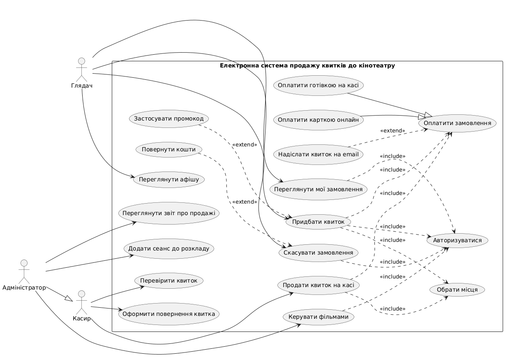

# Електронна система продажу квитків до кінотеатру

## Предметна галузь

Веб-система електронного продажу квитків до кінотеатру на PHP/Laravel. Глядач переглядає афішу, обирає сеанс і місця на схемі зали, оплачує замовлення та отримує електронний квиток із QR-кодом. Персонал кінотеатру керує афішею та розкладом, продає квитки на касі й перевіряє їх на вході.

## Характеристики системи

**Основні функції:**

- перегляд афіші та розкладу сеансів із фільтрацією
- вибір місць на схемі зали
- тимчасове резервування місць на 10 хвилин
- онлайн-оплата та електронний квиток із QR-кодом
- реєстрація, авторизація та особистий кабінет
- скасування замовлення та повернення коштів
- керування фільмами, залами, сеансами та цінами
- продаж і перевірка квитків касиром
- звіти про продажі

**Користувачі:** глядач, касир, адміністратор.

**Архітектура:** MVC (Laravel): маршрути → контролери → моделі Eloquent → база даних (MySQL), відображення через Blade.

**Таблиці бази даних:** `users`, `genres`, `movies`, `movie_genre`, `halls`, `seats`, `showtimes`, `orders`, `tickets`, `payments`.

**Вихідні дані:** афіша та розклад, електронний квиток (PDF), схема зали, звіт про продажі, графік продажів.

## Діаграма варіантів використання

## Use Case: Придбати квиток онлайн

**Scope:** веб-система продажу квитків до кінотеатру (System)

**Level:** User-goal

**Primary Actor:** глядач

**Stakeholders and interests:**

1. Глядач: зацікавлений швидко обрати сеанс і місця, бачити остаточну ціну та безпечно оплатити замовлення.
2. Кінотеатр (власник): зацікавлений у високій заповнюваності залів та відсутності подвійного продажу одного місця.
3. Касир: зацікавлений в актуальних даних про продані квитки для швидкої перевірки на вході.
4. Адміністратор: зацікавлений у коректних даних для звітів про продажі.
5. Платіжна система: зацікавлена в коректних запитах на оплату та підтвердженнях.
6. Податкова адміністрація: зацікавлена в обліку кожної оплати.

**Preconditions:** глядач авторизований у системі; сеанс опубліковано в розкладі, і в ньому є вільні місця.

**Success guarantee:** обрані місця закріплені за глядачем, оплату підтверджено, замовлення збережене в базі даних зі статусом «оплачено», сформовано електронні квитки з QR-кодом і надіслано на email.

**Main Success Scenario:**

1. Глядач відкриває афішу кінотеатру.
2. Система виводить список фільмів із найближчими сеансами.
3. Глядач обирає фільм та зручний сеанс (дату, час, формат).
4. Система показує схему зали з вільними й зайнятими місцями та ціни квитків.
5. Глядач обирає одне або кілька вільних місць.
6. Система тимчасово резервує обрані місця на 10 хвилин і розраховує суму замовлення.
7. Глядач підтверджує вибір і переходить до оплати.
8. Система показує підсумок замовлення та пропонує способи оплати.
9. Глядач обирає оплату карткою онлайн, система перенаправляє його на сторінку платіжного шлюзу.
10. Глядач вводить дані картки та підтверджує оплату.
11. Платіжна система підтверджує оплату і повертає результат у систему.
12. Система змінює статус замовлення на «оплачено», зберігає квитки та платіж у базі даних.
13. Система генерує електронні квитки з QR-кодом і показує їх на екрані.
14. Система надсилає квитки на email глядача, глядач зберігає або друкує їх.

**Extensions:**

- *a) у будь-який час глядач відмовляється від оформлення:
    - 1) глядач натискає «Скасувати»;
    - 2) система звільняє тимчасово зарезервовані місця;
    - 3) система повертає глядача до афіші;
- *b) у будь-який час виникає збій системи:
    - 1) система записує помилку в лог і показує повідомлення «Сталася помилка, спробуйте пізніше»;
    - 2) тимчасове резервування місць знімається автоматично після спливання 10 хвилин;
- 2a) на обрану дату немає сеансів обраного фільму:
    - 1) система виводить відповідне повідомлення;
    - 2) глядач обирає іншу дату чи інший фільм;
- 5a) обране місце вже зайняте іншим глядачем:
    - 1) система повідомляє про це й оновлює схему зали;
    - 2) глядач обирає інше місце;
- 5b) глядач намагається обрати понад 6 місць:
    - 1) система повідомляє про обмеження;
    - 2) глядач зменшує кількість місць;
- 7a) у глядача є промокод:
    - 1) глядач вводить промокод;
    - 2) система перевіряє промокод і перераховує суму замовлення;
    - 2a) промокод недійсний або прострочений: система виводить помилку, глядач продовжує без знижки;
- 7b) час резервування (10 хвилин) минув:
    - 1) система скасовує резервування та повідомляє про це глядача;
    - 2) глядач повертається до вибору місць (крок 4);
- 10a) платіжна система відхилила оплату (недостатньо коштів, неправильні дані картки):
    - 1) система виводить причину відмови;
    - 2) глядач вводить іншу картку або скасовує оформлення (*a);
- 11a) платіжний шлюз не відповідає:
    - 1) система повідомляє про тимчасову недоступність оплати;
    - 2) замовлення зберігається зі статусом «очікує оплати», місця утримуються до кінця резервування;
    - 3) глядач повторює спробу оплати;
- 14a) лист із квитками не доставлено:
    - 1) квитки доступні в особистому кабінеті глядача;
    - 2) глядач може запросити повторне надсилання листа.

**Special Requirements:**

1. адаптивний інтерфейс: схема зали має бути читабельною на екрані смартфона;
2. підтвердження оплати має відображатися протягом 10 секунд у 95 % випадків;
3. передавання даних лише через HTTPS, дані банківських карток у системі не зберігаються;
4. інтерфейс українською та англійською мовами;
5. одне місце на один сеанс не може бути продане двічі (захист на рівні транзакцій і унікального індексу БД).

**Technology and Data Variations List:**

1. оплата через платіжний шлюз карткою або через Apple Pay / Google Pay;
2. вхід за email і паролем або через обліковий запис Google;
3. вибір місць вручну на схемі або автопідбір сусідніх місць;
4. квиток відображається на екрані, надсилається на email у вигляді PDF із QR-кодом і зберігається в особистому кабінеті.

**Frequency of Occurrence:** 85 %.

**Miscellaneous (Open Issues):**

1. чи дозволяти купівлю квитка без реєстрації;
2. як розраховувати знижки для дитячих та студентських квитків;
3. за скільки годин до початку сеансу дозволено повернення квитка;
4. чи потрібне часткове повернення коштів за частину квитків у замовленні.

## Діаграма класів

